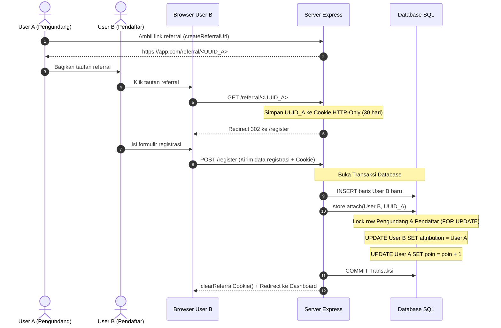

# Arsitektur & Konsep Dasar ModuRef

ModuRef dirancang dengan pendekatan modular, ringan (*zero external runtime dependencies*), dan mudah diintegrasikan ke aplikasi yang sudah berjalan.

---

## 1. Filosofi Desain: Single-Table Architecture

Banyak sistem referral tradisional menggunakan tabel relasi perantara yang terpisah (misalnya tabel `referrals` atau `invitations`). ModuRef memilih pendekatan **Single-Table**:
- Nilai referral disimpan langsung di baris tabel pengguna aplikasi (secara bawaan tabel `users`).
- Hanya membutuhkan 4 kolom inti:
  1. `uuid`: UUID unik pengguna.
  2. `username`: Username pengguna.
  3. `referral_poin`: Total kumulatif undangan yang berhasil.
  4. `referral_attribution`: Snapshot nama pengundang saat pendaftaran.

### Keuntungan:
- **Performa Tinggi**: Tidak memerlukan join antar-tabel saat membaca profil pengguna.
- **Snapshot Attribution**: Username pengundang disimpan sebagai snapshot saat registrasi. Jika pengundang mengganti username di kemudian hari, jejak attribution historis tetap aman.
- **Non-Destructive**: Poin referral adalah counter kumulatif seumur hidup. Jika akun yang diundang kelak dihapus, poin pengundang tidak berkurang.

---

## 2. Siklus Hidup Referral (Lifecycle)



---

## 3. Struktur Modul Kode

Kode sumber package berada di dalam folder `package/src/`:

```text
package/src/
├── index.js              # Barrel export pintu gerbang API publik
├── constants.js          # Nilai konstanta dan regex standar
├── validation.js         # Validasi UUID, sanitasi path, validasi cookie, SQL quoting
├── http.js               # Handler Express router, URL builder, dan cookie getter/clearer
├── store.js              # Logika bisnis transaksi referral (attach, summary, verifikasi skema)
└── adapters/
    ├── index.js          # Re-export adapter bawaan
    ├── mysql.js          # Adapter MySQL / MariaDB via mysql2
    ├── postgres.js       # Adapter PostgreSQL via pg
    └── sqlite.js         # Adapter SQLite via better-sqlite3
```

- **Barrel Pattern**: Semua API publik diekspor ulang melalui `src/index.js`.
- **Tree-Shaking & Bundling**: Saat proses `npm run build`, `esbuild` menelusuri import ini dan menghasilkan satu bundle ringkas `dist/index.js` (~8.4 kB).
